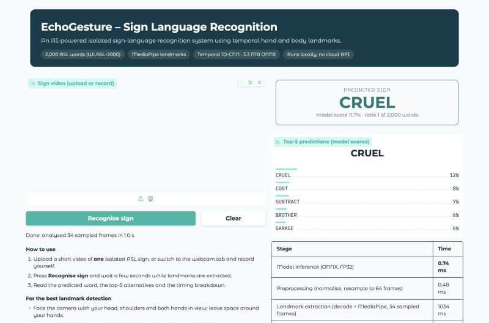
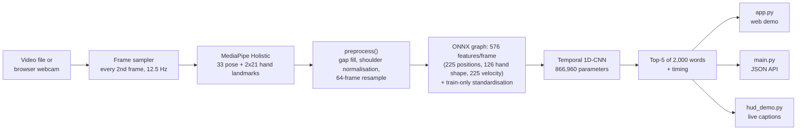

# EchoGesture – Isolated Sign Language Recognition

EchoGesture recognises which of **2,000 American Sign Language (ASL) words** is signed in a short video. It turns each frame into MediaPipe body and hand landmarks and classifies their motion with a small temporal 1D-CNN (3.3 MB ONNX). Everything runs locally, with no cloud API, and a browser app lets anyone try it.

> **Honest headline:** the model reaches **18.90% top-1** and **42.60% top-5** accuracy on 2,000 held-out WLASL test clips. That is far below the 70% target, and it is measured on signers mostly seen during training. See [Limitations](#limitations).

| | |
|---|---|
| Interactive demo | Run locally with `python app.py`. Public link: **not deployed yet**; the deployment files are ready in [deploy/huggingface_space](deploy/huggingface_space/DEPLOY.md) |
| Presentation | [EchoGesture_Presentation.pptx](presentation/EchoGesture_Presentation.pptx) · [PDF](presentation/EchoGesture_Presentation.pdf) |
| Submission package | [submission/EchoGesture_Submission.zip](submission/EchoGesture_Submission.zip) |
| Deliverables checklist | [docs/Deliverables_Status.md](docs/Deliverables_Status.md) |
| AI disclosure | [docs/AI_Disclosure.md](docs/AI_Disclosure.md) |
| Demo video | Pending; script and storyboard in [docs/Demo_Video_Script.md](docs/Demo_Video_Script.md) |



*A real run of the web app on WLASL test clip 60522. The true word is UNDER; the model predicted CRUEL, which is wrong, with UNDER absent from its top 5. The video preview is blank because the browser cannot preview this file's codec.*

## Problem statement

Build a recogniser for **isolated** signed words: one sign per clip, one word out. It must work from an ordinary third-person camera and run entirely on the device, because the camera also films bystanders. It must also be fast enough for conversation.

The track's targets are:
- model size ≤ 20 MB;
- p95 latency ≤ 50 ms;
- top-1 ≥ 70%;
- an occlusion drop of ≤ 5 points;
- average power ≤ 500 mW;
- latency drift ≤ 20% over 10 minutes;
- no cloud.

EchoGesture is isolated word recognition. It is **not** continuous sign-language translation.

## Features

- **Pipeline:** an end-to-end path from video to MediaPipe Holistic landmarks, then normalisation, a 64 × 576 feature sequence and a temporal 1D-CNN that returns the top-5 words.
- **Browser app** (`app.py`, Gradio):
  - video upload or webcam recording;
  - the predicted word, top-5 scores with a ranked bar display, and a timing breakdown;
  - clear errors for unusable videos.
- **Offline API:** `main.py`'s `predict(video_path)` returns JSON with the prediction, confidence, top-5 and latency.
- **Live caption HUD** (`hud_demo.py`): sign segmentation from a webcam, a running caption line, FPS and latency.
- **Models:** FP32 ONNX (deployed, 3.33 MB) and static INT8 ONNX (0.92 MB), with a conversion script.
- **Reproducibility:** reproducible extraction, training, evaluation, benchmarking and submission packaging, with tests.

## Architecture



The model has four stages:
1. Linear 576 → 192, with LayerNorm and ReLU.
2. A residual convolution block (kernel 5, BatchNorm, ReLU).
3. A stride-2 residual block, which halves 64 steps to 32.
4. Temporal mean pooling, then dropout 0.3 and Linear 192 → 2,000.

There are no recurrent, attention or 3D-convolution layers. All three entry points share `src/inference.py`, `src/extract_keypoints.py` and `src/preprocess.py`, so they run the identical pipeline.

## Technology stack

| Component | Technology |
|---|---|
| Language | Python 3.11 |
| Landmarks | MediaPipe 0.10.14 (Holistic) and OpenCV 4.10 |
| Training | PyTorch 2.15 on Apple M4 (MPS) |
| Deployment | ONNX 1.22, ONNX Runtime 1.32 (CPU) |
| Web app | Gradio 6.32 |
| Data | NumPy 1.26, pandas 3.0 |

## Dataset

**WLASL-2000:** Dongxu Li, Cristian Rodriguez Opazo, Xin Yu, Hongdong Li, *"Word-level Deep Sign Language Recognition from Video: A New Large-scale Dataset and Methods Comparison"*, WACV 2020. It has 21,095 videos of 2,000 words by 120 signers. The "WLASL-2000 Resized" Kaggle copy was used.

- **Licence:** WLASL is for academic, computational use (C-UDA). **No WLASL videos are included in this repository or the demo.**
- **Subset used:** a deterministic 10,000-video subset of the official NSLT-2000 splits, with **3 train / 1 val / 1 test clip per word** ([final_manifest.csv](data/processed/final_manifest.csv)).
- **Test set:** evaluated once; never used for tuning or calibration.

## Model and preprocessing details

1. **Extraction:** every 2nd frame goes through MediaPipe Holistic, giving `(T, 75, 3)` in the order pose 0-32, left hand 33-53, right hand 54-74. An undetected group is NaN.
2. **Preprocessing** (`src/preprocess.py`):
   - interior gaps of up to 4 samples are interpolated;
   - the clip is centred on the median shoulder midpoint and scaled by shoulder width;
   - legs are dropped and values are clipped to ±6;
   - the clip is resampled to 64 frames, and missing values become 0.
3. **Features inside the ONNX graph:** 225 normalised positions, 126 wrist-relative upright hand-shape values and 225 masked velocities, standardised with statistics from the 6,000 training clips.
4. **Training:**
   - AdamW (lr 0.002, weight decay 0.05), one-cycle schedule, label smoothing 0.1, batch 64, 150 epochs.
   - Training-only augmentation: time crop, mirror with hand swap, rotation, scale, shift, jitter, hand hiding and point dropout.
   - Best epoch 95, chosen by validation macro-F1.
5. **Export:** the FP32 ONNX output matches PyTorch (max logit difference 1.1e-5). Static INT8 is calibrated on 300 training clips.

## Installation

```bash
git clone https://github.com/shr1989/SAMSUNG_PRISM.git
cd SAMSUNG_PRISM
python3.11 -m venv .venv && source .venv/bin/activate
pip install -r requirements.txt
```

`requirements.txt` pins the full environment, including training and test tools. After installation everything runs offline; the MediaPipe models ship inside its wheel.

## Run the web app

```bash
python app.py          # opens on http://127.0.0.1:7860
```

**Uploading a video:**
1. Drag a short video (MP4, MOV, AVI, MKV, M4V or WebM; at most 15 s and 50 MB) onto the video box.
2. Press **Recognise sign**.
3. The app shows:
   - the predicted word;
   - the top-5 words with model scores;
   - model inference time, separately from the total processing time (decode plus MediaPipe).

**Recording with the webcam:**
1. Click the camera icon under the video box and allow camera access.
2. Record a single sign, stop, then press **Recognise sign**.
3. The recorder is set not to mirror, because the model was trained on unmirrored video.

Webcam recording has **not** been verified by the authors (camera access was blocked in the test environment). Please check it on your machine.

**For good landmark detection:**
- keep your head, shoulders and both hands in view, in even light;
- start and end with your hands lowered;
- sign once at a natural pace.

**Example output:** a real run on test clip 27321 (true word HERSELF) returned AID, SKILL, ASSIST, ARREST and MAKE as the top 5, which is a miss. It reported:
- model inference of under 1 ms;
- total processing of about 0.5 s on an Apple M4 CPU, almost all of it MediaPipe.

Expect many wrong answers, since overall top-1 is 18.9%. The scores are softmax outputs, not calibrated probabilities.

## Other entry points

```bash
python main.py path/to/sign.mp4                 # JSON: prediction, confidence, top5, latency_ms
python main.py path/to/sign.mp4 --model ...     # any ONNX path, e.g. models/exported/model_int8.onnx
python hud_demo.py                              # live webcam caption HUD (camera permission needed)
python hud_demo.py --video path/to/clip.mp4     # replay a file through the live HUD
```

## Tests

```bash
python -m pytest -q
```

The tests cover:
- extraction and keypoint validation;
- preprocessing and features;
- ONNX export parity;
- streaming segmentation;
- the energy meter;
- the web app: input validation, too-short, too-long and person-free videos, WebM decoding, and identical results to `main.predict()`.

Tests that need the WLASL videos or exported models are skipped when those are missing.

## Evaluation results (2,000 test clips, 1 per word)

| Metric | FP32 ONNX (deployed) | INT8 ONNX |
|---|---|---|
| Top-1 | **18.90%** (95% CI 17.25-20.60%) | 18.55% |
| Top-5 | **42.60%** | 40.95% |
| Macro F1 | 0.1459 | 0.1405 |

**Signer overlap:** 1,997 of 2,000 test clips come from signers seen in training.
- Clips whose signer signed the same word in training: 46.6% top-1.
- All others: 17.6%.
- Unseen-signer accuracy is **not established**.

**Calibration:** the scores overstate accuracy. The mean top-1 score is 35.6% against 18.9% correct (ECE 0.173, [calibration_analysis.json](results/reports/calibration_analysis.json)).

**Robustness:**

| Test | Top-1 drop |
|---|---|
| One hand removed from the keypoints for 30% of frames | 1.0 points |
| Keypoints rotated | 0.9 points |
| Dominant hand blacked out in the video pixels, 30% of frames (400 clips) | 4.75 points (95% CI 1.5-8.0) |

## Benchmarks (MacBook Air M4, CPU, ONNX Runtime 1 thread)

| Measurement | Value |
|---|---|
| Model only, p95 (FP32 / INT8) | 0.51 ms / 0.55 ms |
| Live sign end → word, p95 (MediaPipe on the last frame + preprocess + model) | **32.2 ms** |
| Deliberate end-of-sign confirmation wait (not included above) | 320 ms |
| MediaPipe per frame, p95 | 36.1 ms |
| Whole recorded video file through `predict()`, p95 | 1,156 ms |
| Model size (FP32 / INT8) | 3.33 MB / 0.92 MB |
| Latency drift over 10.5 minutes (p95) | +0.8% |
| Average power while signing | **1.42 W**: per-process CPU energy estimate, not total device power, not a phone; fails the 500 mW target |

Full methodology: [results/reports/compliance_report.md](results/reports/compliance_report.md). Every metric versus its target is in the submission package's `results.csv`.

## Limitations

- **Accuracy:** 18.90% top-1 across 2,000 words with 3 training clips per word.
- **Signer overlap:** the test split shares signers with training, so generalisation to new signers is unknown.
- **Calibration:** confidence scores are imperfectly calibrated (they overstate accuracy).
- **Power:** 1.42 W is a per-process CPU estimate on a laptop, not total device power, and it misses the 500 mW target.
- **Unverified:**
  - webcam recording in the app and the live HUD have not been tested with a real camera;
  - nothing has been measured on a phone.
- **Scope:** isolated words only. There is no Android or iOS application.

## Future work

- Train on the full official training split (14,296 clips) with class-balanced sampling.
- Evaluate on held-out signers.
- Lower MediaPipe power when no one is in view, or use a lighter pose model.
- Deploy the prepared Hugging Face Space and verify webcam use.
- Package for ONNX Runtime Mobile and measure on a phone.

## Repository structure

```
app.py                      Gradio web app (upload / webcam -> top-5)
main.py                     predict(video_path) -> JSON
hud_demo.py                 live webcam caption HUD
src/                        pipeline: config, extraction, preprocessing, model, training,
                            evaluation, export/quantization, inference, streaming, benchmarks
tests/                      pytest suite
models/exported/            model_fp32.onnx (deployed), model_int8.onnx
models/checkpoints/tcnn/    best.pt (epoch 95), history.csv
data/processed/             preprocess_config.json, feature_stats.npz, manifests (no videos)
results/                    results.csv, reports/, plots/
presentation/               PPTX + PDF and the scripts that build them from the reports
deploy/huggingface_space/   Space template and deployment guide
tools/                      submission packaging/verification, Space builder, calibration report
submission/                 EchoGesture_Submission.zip (final package)
docs/                       AI disclosure, deliverables status, demo video script, images
kaggle/, EchoGesture_Kaggle.ipynb   earlier Kaggle packaging (not used for the final results)
```

## Submission package

```bash
python tools/build_submission.py assemble --name EchoGesture_Submission --rebuild
(cd submission/EchoGesture_Submission && python -m src.make_predictions --videos-dir <WLASL videos>)
python tools/build_submission.py results --name EchoGesture_Submission
python tools/build_submission.py zip --name EchoGesture_Submission
python tools/verify_submission.py submission/EchoGesture_Submission
```

**What the package contains:**
- source code, both ONNX models and the checkpoint;
- the preprocessing config, feature statistics and manifests;
- `predictions.jsonl` for all 2,000 test clips, produced by `predict()`;
- `results.csv`, the README and the evaluation reports.

**How it was verified:**
- its predictions match the original evaluation on 2,000 of 2,000 clips;
- it runs in a clean Python 3.11 environment with network access blocked.

## Team

Team member names are not recorded in the project files and are to be added by the team. Repository: [github.com/shr1989/SAMSUNG_PRISM](https://github.com/shr1989/SAMSUNG_PRISM).
